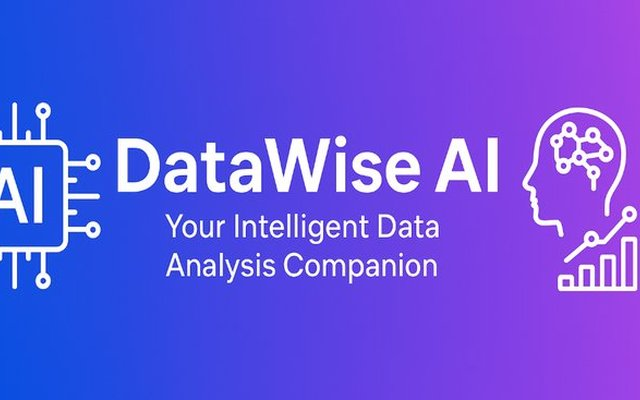
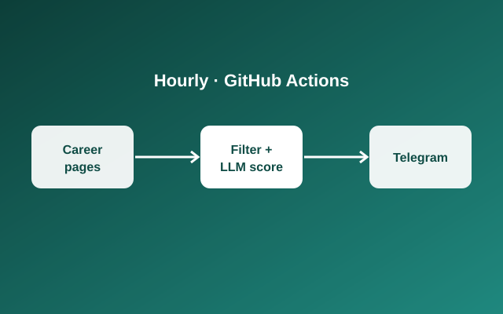
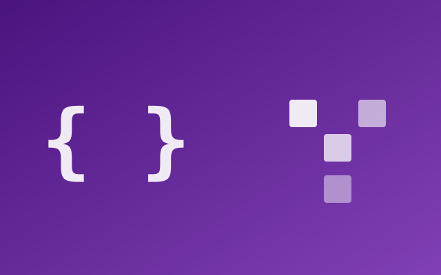
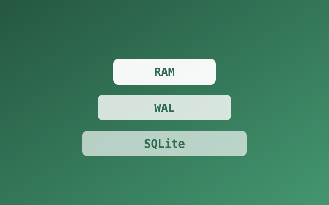
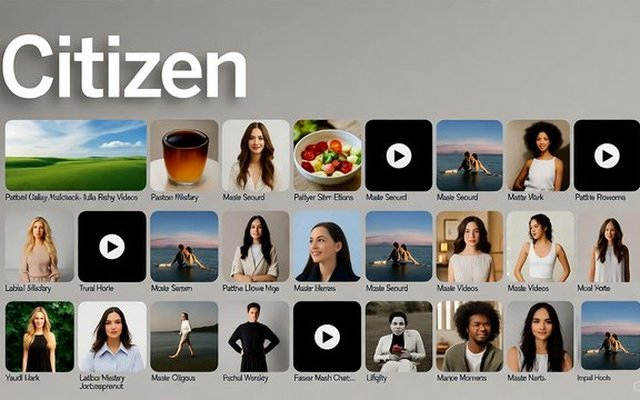
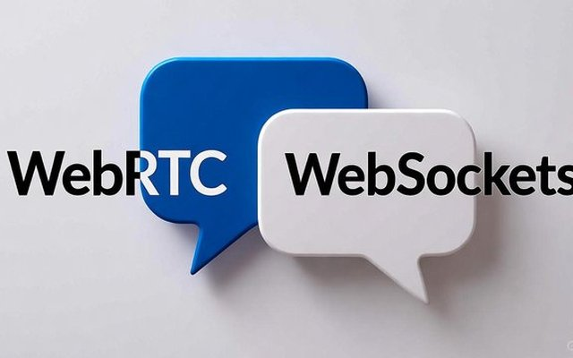
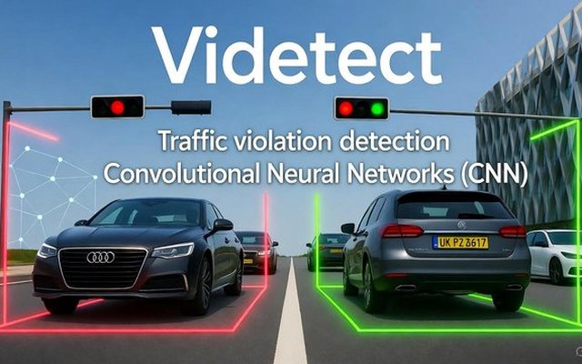
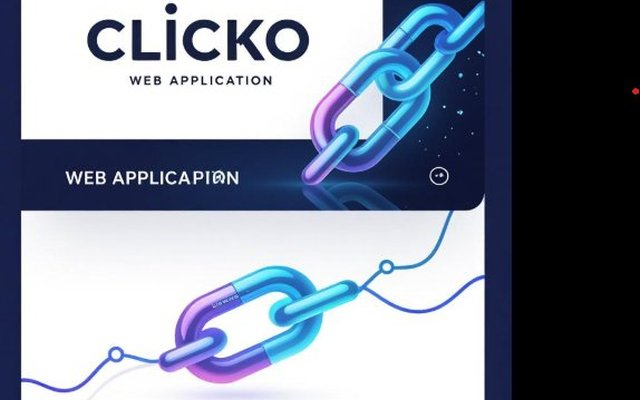

 

  

 

## 🧭 What I do

<table>
<tr>
<td width="33%" valign="top">

### 🤖 AI agents
Multi-agent LLM systems: a router agent that classifies intent and hands off to specialist tool-calling agents, running on **self-hosted LLMs with MCP and RAG**.

</td>
<td width="33%" valign="top">

### 📊 Data & analytics
KPIs, models and dashboards that product teams act on, built with **SQL, Snowflake, Python and Power BI**. At Fidelity, my Customer Effort Score replaced NPS as the app-health metric.

</td>
<td width="33%" valign="top">

### 🛠️ Full-stack
Backends in **FastAPI, Flask and Node.js** with React frontends, plus real-time apps (**WebSockets, WebRTC**), Docker and AWS. I also maintain a published npm package.

</td>
</tr>
</table>

## 🔥 Featured projects

<table>
<tr>
<td width="33%" valign="top">

<b><a href="https://github.com/yashwanthchikki/datawise">DataWise</a></b> 
Ask a database questions in plain English; it writes the SQL and builds the charts. 
<code>LangChain</code> <code>ChromaDB</code> <code>PostgreSQL</code>
</td>
<td width="33%" valign="top">

<b>Job Alerts Pipeline</b> 
Checks 60+ career boards hourly, filters and LLM-scores new roles, and pings Telegram. 
<code>GitHub Actions</code> <code>Groq LLM</code> <code>Python</code>
</td>
<td width="33%" valign="top">

<b><a href="https://github.com/yashwanthchikki/close_claw">SortOS</a></b> 
Offline, privacy-first voice desktop agent with local STT/TTS and JSON tool calling. 
<code>Local LLM</code> <code>Speech-to-Text</code> <code>Python</code>
</td>
</tr>
<tr>
<td width="33%" valign="top">

<b><a href="https://github.com/yashwanthchikki/game">CodePixel Arena</a></b> 
Real-time multiplayer game where players fight by writing Python strategies. 
<code>React</code> <code>Socket.IO</code> <code>Python</code>
</td>
<td width="33%" valign="top">

<b><a href="https://github.com/yashwanthchikki/counter_npm">Three-State Counter</a></b> · <a href="https://www.npmjs.com/package/three-state-counter">npm</a> 
Crash-safe RAM → WAL → SQLite counter library, ~100k ops/sec with log recovery. 
<code>Node.js</code> <code>SQLite</code> <code>WAL</code>
</td>
<td width="33%" valign="top">

<b><a href="https://github.com/yashwanthchikki/citizen">Citizen</a></b> 
AI news platform with RAG semantic search, JWT + RBAC and S3 media streaming. 
<code>React</code> <code>FAISS</code> <code>MongoDB</code>
</td>
</tr>
<tr>
<td width="33%" valign="top">

<b><a href="https://github.com/yashwanthchikki/vendo">Vendo</a></b> 
Encrypted messaging with WebRTC audio/video calls, no phone number needed. 
<code>WebRTC</code> <code>WebSockets</code> <code>Docker</code>
</td>
<td width="33%" valign="top">

<b><a href="https://github.com/yashwanthchikki/videtect">ViDetect</a></b> 
Flags red-light violations from traffic video with object detection and tracking. 
<code>YOLOv3</code> <code>OpenCV</code> <code>Python</code>
</td>
<td width="33%" valign="top">

<b><a href="https://github.com/yashwanthchikki/Clicko">Clicko</a></b> · <a href="https://github.com/yashwanthchikki/tick_tack_toe">+ Tic-Tac-Toe Arena</a> 
URL shortener with expiring links and a click-analytics dashboard. 
<code>Express</code> <code>Redis</code> <code>MongoDB</code>
</td>
</tr>
</table>

## 💼 Experience

<b>MapmyIndia (Mappls)</b> · Software Engineer, contract via Brick Solutions · <i>Oct 2026 – present</i>

 

*AI automation & geospatial analytics platform for DRDO (CAIR)*
- Designed a **multi-agent architecture**: a router agent classifies natural-language queries and dispatches them to **10 specialist agents** (warning-area lookup, geospatial computations, ENC chart data, live web scraping, licensed data-feed APIs), replacing manual analyst workflows with one conversational interface
- Built the agents as **Python tool-calling functions** (the LLM picks the tool and parameters, deterministic code executes) and as **MCP client-server tools**, on **self-hosted LLMs with RAG**
- Validate and normalise multi-source, real-time data into structured reports

<b>Fidelity Investments</b> · Apprentice, Analytics & Machine Learning · <i>Feb 2025 – Feb 2026</i>

 

- **Customer Effort Score:** designed a new friction KPI and a 12-feature logistic-regression model to flag high-effort transactions; CES replaced NPS as the primary app-health metric
- **Transaction intent classifier:** multi-class model across 88 transaction types
- **Page prioritisation engine (Streamlit):** ranks app pages on 9 weighted features with live scenario simulation
- **Advisor ranking:** moved ranking from AUM-only to 16 strategic features
- **Digital analytics dashboard:** Power BI on Snowflake for visits, unique visitors and product usage

<b>Innosights Soft Solutions</b> · Machine Learning Intern · <i>Feb – Apr 2024</i>

 

- Custom CNN for plant-disease detection on 61,000+ images (94.2% validation accuracy), served via a Flask API with sub-200 ms inference

## 🧰 Toolbox

   
  

  
  
  
  
  
  
  
  
  
  
  
  

## 🐍 Contribution activity

  <picture>
    <source media="(prefers-color-scheme: dark)" srcset="https://raw.githubusercontent.com/yashwanthchikki/yashwanthchikki/output/github-snake-dark.svg">
    <source media="(prefers-color-scheme: light)" srcset="https://raw.githubusercontent.com/yashwanthchikki/yashwanthchikki/output/github-snake.svg">
    
  </picture>

🎓 B.E. Artificial Intelligence & Machine Learning · Dayananda Sagar College of Engineering, 2024

